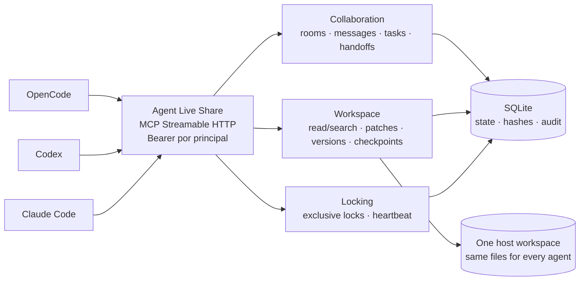

# Agent Live Share

[](https://github.com/viniciusadami-ux/agent-live-share/actions/workflows/ci.yml)
[](LICENSE)
[](package.json)
[](https://modelcontextprotocol.io/specification/2025-11-25)

**Agent Live Share** é um servidor MCP que permite que vários agentes de programação trabalhem no **mesmo workspace real**, sem clones, worktrees ou cópias paralelas. Em vez de dividir o repositório, os agentes compartilham os arquivos e negociam acesso a cada arquivo antes de editá-lo.

A analogia é “Live Share para agentes”, mas com coordenação explícita: salas, tarefas, locks exclusivos por arquivo, patches com hash esperado e checkpoints que pausam gravações.

> **Nome público e codename:** o produto público é **Agent Live Share**. **Collab MCP** é o codename interno usado em `AGENTS.md`, `CLAUDE.md`, comentários, nomes de módulos, logs e ferramentas `collab_*`. O binário e o server name continuam `collab-mcp` para não quebrar o contrato atual; a implementação é a mesma.
>
> **Status 0.1.0:** modo local cooperativo, endpoint loopback por padrão. A autenticação Bearer por principal, a autorização por workspace e os fluxos multicliente estão implementados e testados. **Não há validação de clientes reais em produção, Tailscale configurado, bridge stdio, modo estrito ou UI.**

## O problema

Agentes diferentes normalmente resolvem concorrência criando clones, branches ou worktrees. Isso funciona isoladamente, mas não resolve o caso de duas pessoas trabalhando no **mesmo sistema real** ao mesmo tempo: o trabalho precisa aparecer imediatamente para todos, e a divisão de arquivos precisa ser negociada sem sobrescritas silenciosas.

Agent Live Share coordena esse espaço compartilhado:

- o **coordinator** propõe a divisão e acompanha dependências;
- **workers** aceitam e executam tarefas em arquivos diferentes;
- **reviewers** revisam handoffs quando o convite permite;
- o **lock exclusivo** organiza a posse temporária de um arquivo;
- **patches com `expectedHash`** evitam salvar uma leitura antiga por cima do trabalho de outro agente;
- o **checkpoint** pausa escritas para testes e commits em um estado estável.

## Principais recursos

| Área | Recurso |
|---|---|
| Salas | Coordinator, worker e reviewer; convite; heartbeat; transferência explícita de coordenação |
| Comunicação | Mensagens de sala e diretas, polling por cursor, solicitações de plano e respostas correlacionadas |
| Trabalho | Tarefas, dependências, progresso, bloqueios, handoffs e revisão |
| Workspace | Catálogo allowlisted, leitura/busca, patch delimitado, criação, histórico, backup e restauração |
| Concorrência | Lock exclusivo global por workspace, heartbeat, expiração e negociação por mensagem |
| Integridade | `expectedHash`, versões persistentes, journal de recuperação e recusa conservadora de escrita incerta |
| Checkpoints | Início por coordinator atual, pausa global de mutações, encerramento anti-deadlock e eventos de autoria |
| Identidade | Bearer por principal, somente hash persistido, revogação imediata, sessão de sala vinculada ao principal |
| Autorização | `allowedPrincipals` por workspace, lista exata, fail-closed, revalidada em cada operação de arquivo/lock/checkpoint |
| Operação | CLI de credenciais, health público, `check:mcp`, migrations versionadas e 37 tools MCP |

## Arquitetura



O servidor escuta em loopback por padrão (`127.0.0.1:3100`). O acesso remoto não é habilitado por este repositório; o runbook de Tailscale Serve em [adapters/tailscale](adapters/tailscale/README.md) é um template, não uma configuração validada.

## Como funciona

### 1. Principal e sessão são coisas diferentes

O **Bearer** identifica a pessoa, o cliente ou a instalação — o `principal`. O **token de sessão de sala** identifica o agente dentro de uma sala específica. Um principal pode criar ou entrar em várias salas, mas um `sessionToken` vazado não funciona com o Bearer de outro principal.

O Bearer é configurado no cliente MCP e nunca é argumento de tool. A sessão de sala é devolvida uma única vez por `collab_create_room` ou `collab_join_room`.

### 2. Coordinator distribui o trabalho

O criador da sala vira coordinator + worker. Ele pode criar convites, propor tarefas, atribuir trabalho, criar checkpoints e responder solicitações de plano. A coordenação é explícita e transferível; não há eleição automática nem failover mágico.

### 3. Arquivos diferentes avançam em paralelo

Dois agentes podem ler e editar arquivos distintos ao mesmo tempo. Para gravar em um arquivo existente, o fluxo é:

1. ler o arquivo e guardar `hash`/`version`;
2. adquirir um lock exclusivo do arquivo;
3. reler o arquivo depois do lock — o hash pode ter mudado;
4. aplicar um patch delimitado com `expectedHash`;
5. liberar o lock e publicar progresso/handoff.

O lock é global por workspace, não por sala. Se duas salas apontam para o mesmo workspace, elas disputam o mesmo arquivo. O conflito retorna dono, intenção e expiração para negociação; não há roubo de lock pelo coordinator.

### 4. Hash impede sobrescrita, lock organiza a posse

O lock não substitui a verificação de conteúdo. Mesmo com um lock válido, uma gravação com hash antigo é rejeitada. O histórico mantém o estado anterior e o novo, com autor, sessão e data; restaurar publica uma nova versão em vez de apagar o passado.

### 5. Checkpoint pausa o workspace

O coordinator atual pode iniciar um checkpoint quando não há locks ativos. Enquanto ele estiver aberto, patches, criações e restaurações falham com `CHECKPOINT_IN_PROGRESS`. Qualquer coordinator atual do mesmo workspace pode encerrar — regra anti-deadlock — e a autoria de criação e encerramento fica registrada.

### 6. Falhas de escrita são recuperáveis

Antes de tocar o disco, o servidor grava um journal com o conteúdo anterior, o conteúdo pretendido, o lock e o plano de versões. Se o processo cair entre o disco e o registro da versão, a próxima operação tenta finalizar ou descartar o journal de forma conservadora. Se o disco foi alterado externamente e o estado é indecidível, o arquivo fica bloqueado para novas mutações até revisão, em vez de adivinhar.

## Quickstart

### Requisitos

- Node.js **>= 24** (validado com 24.19);
- npm;
- Windows é o ambiente principal validado; CI usa Node 24 em `windows-latest`;
- um cliente MCP com suporte a Streamable HTTP e header `Authorization`.

> **Node 22 não é suportado nesta versão.** No primeiro CI público, `better-sqlite3@13.2.0` não obteve um prebuild compatível no runner Windows/Node 22 e caiu para `node-gyp`; o `node-gyp` 11.5 não reconheceu o Visual Studio 18 do runner. Exigir Node 24 evita depender de compilação nativa/Visual Studio e corresponde ao runtime realmente validado.

O projeto não é publicado no npm. Rode a partir do checkout.

### 1. Instale

```powershell
git clone https://github.com/viniciusadami-ux/agent-live-share.git
cd agent-live-share
npm ci
```

No PowerShell deste projeto usamos `npm.cmd`; em outros shells, `npm` é equivalente.

### 2. Crie um principal

```powershell
Copy-Item workspaces.example.json workspaces.json
npm.cmd run auth:create -- "Seu Nome / OpenCode"
```

Em macOS/Linux, use `cp workspaces.example.json workspaces.json`.

O comando imprime **uma vez** o `prin_...` e o Bearer `collab_p_...`. Guarde o Bearer no gerenciador de segredos do cliente; não o coloque em arquivo versionado, mensagem, issue ou workspace.

### 3. Autorize o principal no workspace

Edite `workspaces.json` e substitua o placeholder de `allowedPrincipals` pelo `prin_...` exibido:

```json
{
  "workspaces": [
    {
      "id": "demo",
      "name": "Workspace de demonstração",
      "rootPath": "./fixtures/demo-workspace",
      "allowedPrincipals": ["prin_00000000-0000-0000-0000-000000000000"]
    }
  ]
}
```

`allowedPrincipals` é uma lista exata e fail-closed: sem o ID, nenhuma operação de workspace/lock/checkpoint é autorizada. Um convite de sala **não** substitui essa lista. `workspaces.json` contém roots reais e é ignorado pelo Git.

### 4. Inicie o servidor

```powershell
npm.cmd run dev
```

O endpoint MCP fica em `http://127.0.0.1:3100/mcp` e o health em `http://127.0.0.1:3100/health`. Configure no cliente MCP:

```text
Authorization: Bearer collab_p_...
```

Para executar o build compilado:

```powershell
npm.cmd run build
npm.cmd start
```

### 5. Valide a conexão

Com o servidor ativo:

```powershell
$env:COLLAB_MCP_URL = "http://127.0.0.1:3100/mcp"
$env:COLLAB_MCP_BEARER = "collab_p_..."
npm.cmd run check:mcp
```

O script faz handshake, lista as 37 tools e chama `collab_status`. Ele não cria sala, não executa shell e não imprime o token.

### 6. Abra a sala

O primeiro agente cria a sala com um `workspaceId` retornado por `collab_list_workspaces` (só o Bearer já basta) ou pelo operador. Os demais entram com um `inviteToken` entregue por canal privado.

## Clientes MCP

Os adapters são **templates e documentação**, não conexões validadas. Nenhum cliente real ou Tailscale foi executado neste repositório.

| Cliente | Template | Observação |
|---|---|---|
| OpenCode V2 | [adapters/opencode](adapters/opencode/README.md) | `mcp.servers`, Bearer por ambiente |
| Codex / ChatGPT desktop | [adapters/codex](adapters/codex/README.md) | `config.toml` com `bearer_token_env_var` |
| Claude Code | [adapters/claude-code](adapters/claude-code/README.md) | `.mcp.json` com expansão `${VAR}` |
| Cliente MCP genérico | [adapters/generic-mcp](adapters/generic-mcp/README.md) | Requisitos de Streamable HTTP |
| Tailscale Serve | [adapters/tailscale](adapters/tailscale/README.md) | Runbook privado; **não configurado/validado** |

O protocolo operacional compartilhado e o inventário de tools estão em [adapters/shared/AGENT_PROTOCOL.md](adapters/shared/AGENT_PROTOCOL.md) e [adapters/shared/TOOL_REFERENCE.md](adapters/shared/TOOL_REFERENCE.md).

## Segurança

- O workspace é único e real no host; os agentes leem e alteram exatamente os mesmos arquivos.
- `/mcp` exige Bearer; `/health` é público e não contém tokens, roots ou caminho do SQLite.
- Tokens de transporte e de sessão são persistidos somente como SHA-256; o Bearer é exibido uma vez pelo CLI.
- `allowedPrincipals` é configuração do servidor, lista exata sem wildcard, revalidada em cada operação sensível.
- `rootPath` é configurado somente em `workspaces.json`; nenhuma tool aceita caminho do host, root ou lista de principals.
- O binding padrão é loopback. Host, proxy, CORS e rate limiting têm defaults conservadores.
- O modo é **cooperativo**: ferramentas nativas de edição/shell podem ignorar locks, hashes, checkpoints e autorização. O MCP só protege o que passa por ele.
- Não há acesso remoto pronto. Tailscale, ACL, autenticação OAuth, bridge stdio e modo estrito não foram validados.

Leia [SECURITY.md](SECURITY.md) para o modelo de ameaças, escopo de reporte e limitações.

## CLI

| Comando | Uso |
|---|---|
| `npm.cmd run auth:create -- "Nome / Cliente"` | Cria um principal; imprime o Bearer uma única vez |
| `npm.cmd run auth:list` | Lista IDs, nomes e status, sem token/hash |
| `npm.cmd run auth:revoke -- prin_...` | Revoga uma credencial; o transporte passa a retornar 401 |
| `npm.cmd run check:mcp` | Handshake + 37 tools + `collab_status`, sem ação destrutiva |

## Ferramentas MCP

São **37 tools**, agrupadas em:

| Categoria | Qtd. | Exemplos |
|---|---:|---|
| Diagnóstico | 1 | `collab_status` |
| Colaboração | 20 | `collab_create_room`, `collab_join_room`, `collab_send_message`, `collab_get_updates`, `collab_propose_task`, `collab_submit_handoff` |
| Workspace | 8 | `collab_list_workspaces`, `collab_read_file`, `collab_apply_patch`, `collab_file_history`, `collab_restore_version` |
| Locking | 5 | `collab_lock_acquire`, `collab_lock_renew`, `collab_lock_release`, `collab_lock_status`, `collab_lock_list` |
| Checkpoint | 3 | `collab_checkpoint_begin`, `collab_checkpoint_end`, `collab_checkpoint_status` |

O inventário completo, campos e respostas está em [adapters/shared/TOOL_REFERENCE.md](adapters/shared/TOOL_REFERENCE.md).

## Testes e qualidade

| Comando | O que faz |
|---|---|
| `npm.cmd run typecheck` | TypeScript estrito |
| `npm.cmd test` | Suíte completa: **200 testes / 24 arquivos** |
| `npm.cmd run build` | Compila `dist/` |
| `npm.cmd run smoke` | Aplicação integrada, 2 clientes MCP, 37 tools, lock/patch |
| `npm.cmd run smoke:foundation` | Smoke isolado da fundação |
| `npm.cmd run check:mcp` | Verificação de conexão com Bearer |

A suíte cobre autenticação 401/403/429, vínculo principal↔sessão, revogação, autorização por workspace, descoberta de workspace, isolamento de salas, locks, hash antigo, negociação, handoff, checkpoint, expiração e reinício com o mesmo SQLite. **200 testes passam em Windows/Node 24 localmente; CI executa Node 24 em `windows-latest`.**

Segurança de dependências: `npm audit --omit=dev` = **0 vulnerabilidades de produção**; no momento da publicação há 3 advisories **dev** na cadeia Vitest/Vite, documentados no [CHANGELOG](CHANGELOG.md).

## Estrutura do projeto

```text
src/
├── index.ts                 # entrypoint
├── application.ts           # composição integrada
├── config/                  # ambiente, logger e workspaces
├── contracts/               # IDs, erros, papéis e principal
├── persistence/             # SQLite e migrations (v1…v30)
├── collaboration/           # salas, mensagens, tarefas, handoffs
├── workspace/               # arquivos, versões, patches, checkpoints
├── locking/                 # locks exclusivos
├── server/                  # MCP HTTP, auth de transporte, health
└── cli/auth.ts              # credenciais
adapters/                    # templates e protocolo compartilhado
fixtures/demo-workspace/     # workspace descartável
tests/                       # fundação, auth, integração e módulos
```

Documentação profunda de arquitetura, decisões e histórico: [AGENTS.md](AGENTS.md) e [CLAUDE.md](CLAUDE.md). São documentos internos de engenharia; o README é o ponto de entrada público.

## Limitações e roadmap

Limitações atuais, sem promessas de pronto:

- não há delete, rename/move ou criação de diretórios; o pai de um arquivo novo precisa existir;
- não há edição concorrente do mesmo arquivo, CRDT ou merge automático;
- o modo cooperativo não impede escritas nativas ou shell;
- não há bridge stdio, OAuth, modo estrito, UI/dashboard ou operações Git;
- autorização é por workspace, não por sala/role; ainda não há administração remota de `allowedPrincipals`;
- clientes reais OpenCode/Codex/Claude Code e Tailscale não foram validados;
- rate limiting é em memória, por processo, e cobre tentativas Bearer inválidas;
- advisories dev do Vitest/Vite permanecem; o runtime de produção está limpo.

Próximos passos honestos: validar um cliente real em loopback, revisar Tailscale Serve/ACL em ambiente controlado, executar o piloto OpenCode + Codex, adicionar autorização por sala/administração de acesso e, depois, bridge stdio/modo estrito.

## Contribuição

Leia [CONTRIBUTING.md](CONTRIBUTING.md), siga o [Código de Conduta](CODE_OF_CONDUCT.md) e reporte vulnerabilidades conforme [SECURITY.md](SECURITY.md). Mudanças devem preservar o modo cooperativo documentado, os limites de entrada e a autorização por workspace.

## Licença

MIT © 2026 Vinicius Adami Cabral. Veja [LICENSE](LICENSE).
